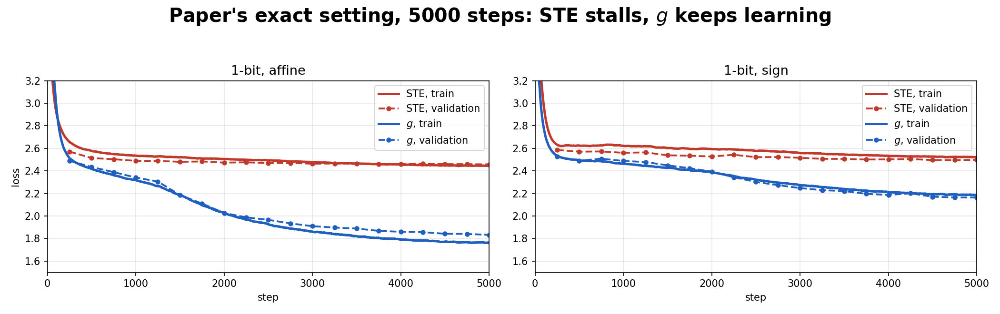
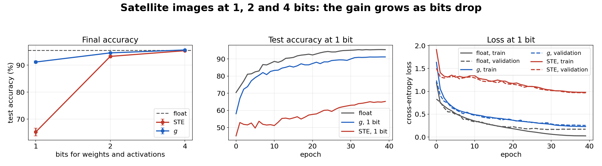

# robust-lowbit-training

Study and reimplementation of **Robust Training of Neural Networks at Arbitrary Precision and Sparsity** (Ye et al., Google DeepMind, ICLR 2026) — [OpenReview](https://openreview.net/forum?id=e6nZrzSccj).

We explain why standard quantization-aware training breaks at 1 bit and how the paper fixes it, then test the fix ourselves on a 1-bit GPT trained on Shakespeare (the paper's setup) and a 1-bit vision transformer trained on satellite images.

Slides: [`docs/slides.pdf`](docs/slides.pdf). By Ayush Srivastava and Sarvesh Nikas (IIT Delhi). This is an independent study, not the authors' code.

## 1. Quantization

Large models have billions of weights, each stored in 16 or 32 bits. That makes them too big for a phone, slow, and costly in energy. Quantization stores each weight and activation in 4, 2 or even 1 bit.

For a block $x\in\mathbb R^N$ of weights (one row) or activations (one token):

$$x\ \xrightarrow{f}\ f(x)\ \xrightarrow{\text{round}}\ q\ \xrightarrow{s_fq+b_f}\ \hat x\ \longrightarrow\ \text{rest of network}\ \longrightarrow\ L$$

- $f(x)=(x-b_f)/s_f$ maps $x$ onto the $k$-bit grid $\lbrace 0,\dots,2^k-1\rbrace$, with $s_f=(x_{\max}-x_{\min})/(2^k-1)$ and $b_f=x_{\min}$.
- $q=\text{round}(f(x))=f(x)+\delta$ are the stored integers, with rounding error $|\delta_i|\le\frac12$.
- $\hat x=s_fq+b_f=x+s_f\delta$ is what the next layer sees.

**During training**, the float weights are kept. Every step they are quantized and rebuilt, then multiplied in float, so gradients can flow. **During inference**, only the integers $q_W$ are stored, plus a scale and shift per row. The layer does an integer matmul $q_Xq_W$, then rescales. Both orders give the same output.

## 2. The problem: the true gradient is zero

By the chain rule, $\partial\hat x/\partial x=s_f\cdot\partial q/\partial f(x)\cdot 1/s_f$, which is just the slope of round. Round is a staircase, so its slope is zero almost everywhere and $\nabla_xL=0$. A small change in $x$ does not change $q$, so training cannot start.

## 3. The standard fix: Straight-Through Estimator (STE)

STE rounds in the forward pass but treats the rounding error as a constant in the backward pass:

$$q=f(x)+\text{stopgrad}(\delta),\qquad \frac{\partial\hat x}{\partial x}=I,\qquad \nabla_xL=\nabla_{\hat x}L .$$

In PyTorch: `q = fx + (torch.round(fx) - fx).detach()`.

**The blind spot.** The forward pass moves every value by $s_f\delta$, but the backward pass is the identity, as if there were no quantization at all. $\delta$ never appears in the gradient, so earlier layers cannot learn to be robust to rounding. At 8 bits $\delta$ is tiny and this is harmless. At 1–2 bits the error is as large as the values themselves, so STE performs poorly and can diverge (paper, Fig. 1a).

## 4. The fix: a fitted reconstruction $g$

The paper keeps $f$ and round, and replaces $\hat x$ with an affine map fitted to $x$ by ridge regression:

$$g(q)=s_gq+b_g,\qquad \min_{s_g,b_g}\ \frac1{2N}\lVert s_gq+b_g-x\rVert^2+\frac\lambda2 s_g^2 ,$$

$$s_g=\frac{\text{Cov}(x,q)}{\text{Var}(q)+\lambda},\qquad b_g=\bar x-s_g\bar q,\qquad \lambda=0.01 .$$

$\lambda$ is the regularization strength. It keeps $s_g$ small and avoids dividing by zero when all the codes are equal. The extra cost is one mean, one variance and one covariance per block.

## 5. Why it works: the backward pass sees $\delta$

In both methods, round is still straight through: $\partial q/\partial x=I/s_f$. Only the step after round differs.

- **STE:** the local gradient is $I$, whatever $\delta$ is.
- **With $g$:** the gradient reaches $x$ by two paths:

$$\nabla_xL=\Big(\underbrace{\tfrac1{s_f}\tfrac{\partial g}{\partial q}}_{\text{through }q}+\underbrace{\tfrac{\partial g}{\partial x}}_{\text{through }x}\Big)^{\top}\nabla_gL .$$

Through $q$, $s_g$ and $b_g$ depend on the residual $x-g(q)$, so the gradient now changes with the rounding error. Through $x$, with $q$ held fixed, $g$ is a projection onto the span of $\lbrace\mathbf 1,q\rbrace$. That path is exact, but it carries no information about $\delta$.

## 6. Results from the paper

Gemma 3 1B, trained from scratch on C4 (next-token accuracy):

| bits (weights and activations) | STE | with $g$ | gain |
|---|---|---|---|
| 4 | 0.425 | 0.427 | +0.002 |
| 2 | 0.379 | 0.403 | +0.024 |
| 1 | 0.340 | 0.375 | +0.035 |

The fewer the bits, the bigger the gain.

The method also extends to sparsity, since pruning is just one more rounding step before $g$. A 4B model with 1-bit weights and half its weights pruned (650 MB, 0.452) beats the full-precision 1B model (1400 MB, 0.449).

At 4 bits, ResNet-50 on ImageNet and a translation model match full precision.

## 7. Our implementation

### 7.1 The paper's 1-bit GPT

**Problem.** Does STE really fail at 1 bit, and does $g$ fix it? We rebuilt the paper's nanoGPT experiment: a 6-layer, 10.7M-parameter character-level GPT on Shakespeare, with the paper's settings (batch 64, context 256, 5000 steps). Every linear layer uses 1-bit weights and activations.

**Solution.** A single quantized linear layer with a switch between STE's $\hat x$ and ridge $g$. Everything else (seed, data, optimizer) is identical, so only the reconstruction differs.



**Results.**
- **STE stalls while $g$ keeps learning:** final loss 2.41 against 1.65.
- **$g$ reproduces the paper's curve,** within 0.05 at every checkpoint.
- **STE's loss does not blow up, unlike the paper's** (which climbs to about 6). In our smaller debugging runs, the blow-up happens *inside* the network instead: STE's residual stream grows to about 250× its size under $g$, and LayerNorm hides this from the loss. Without LayerNorm the gap disappears.

Details: [`implementation/README.md`](implementation/README.md) and [`implementation/onebit/README.md`](implementation/onebit/README.md).

### 7.2 A real-world task: satellite images

**Problem.** Label each EuroSAT satellite image as one of 10 land types (forest, river, …). The model is a small vision transformer (2.7M parameters, 6 layers, 10.8 MB at 32 bits), quantized to 4, 2 and 1 bit.

**Solution.** The same quantized layer and the same training recipe, comparing STE against $g$.



**Results** (test accuracy in %; full precision is 95.4% at 10.8 MB):

| | 4 bits | 2 bits | 1 bit |
|---|---|---|---|
| STE | 95.4 | 93.3 | 65.2 |
| with $g$ | 95.6 | 94.5 | **91.2** |
| gain | +0.2 | +1.2 | **+26.0** |
| size (MB) | 1.64 | 0.97 | 0.64 |
| reduction | 6.6× | 11.1× | 16.9× |

At 1 bit, $g$ keeps the model usable (91%) at 17× smaller, while STE drops to 65%.

## 8. Takeaways

- **Advantages:** makes 1-bit training work, reconstructs $x$ better than standard dequantization, and extends to sparsity.
- **Limitations:**
  - Round is still straight through, so the paper's claim of "without gradient estimation" is too strong.
  - The gain at 4 bits is small.
  - The energy and storage savings are estimates, with no speed measured on real hardware.
- **Lesson:** rounding error looks ignorable, but training needs its information. Fitting the reconstruction to the data is a cheap way to provide it.

## Repository

```
docs/slides.{tex,pdf}        final presentation
figs/                        figures from the paper
implementation/              toy GPT: quantizer, STE vs. ridge g, gradient checks, debugging runs
implementation/onebit/       paper-exact 1-bit GPT on Shakespeare
implementation/vit/          1-bit vision transformer on EuroSAT
implementation/ecg/          1-bit heartbeat classifier on MIT-BIH ECG
```
