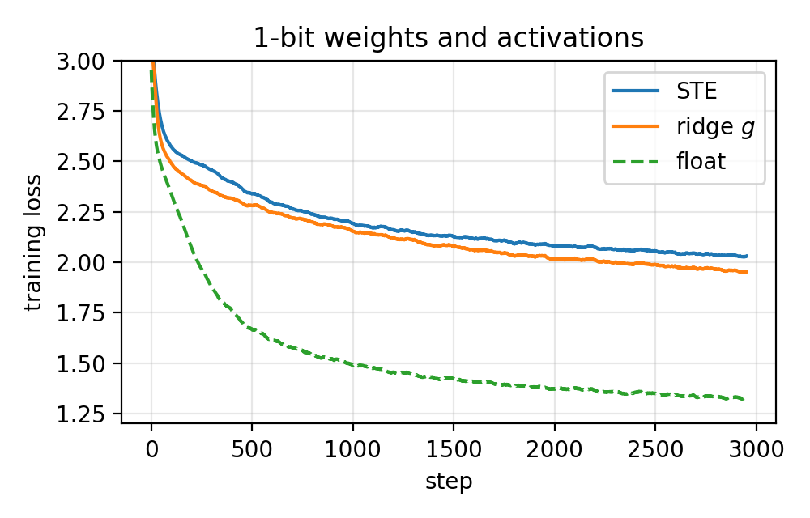
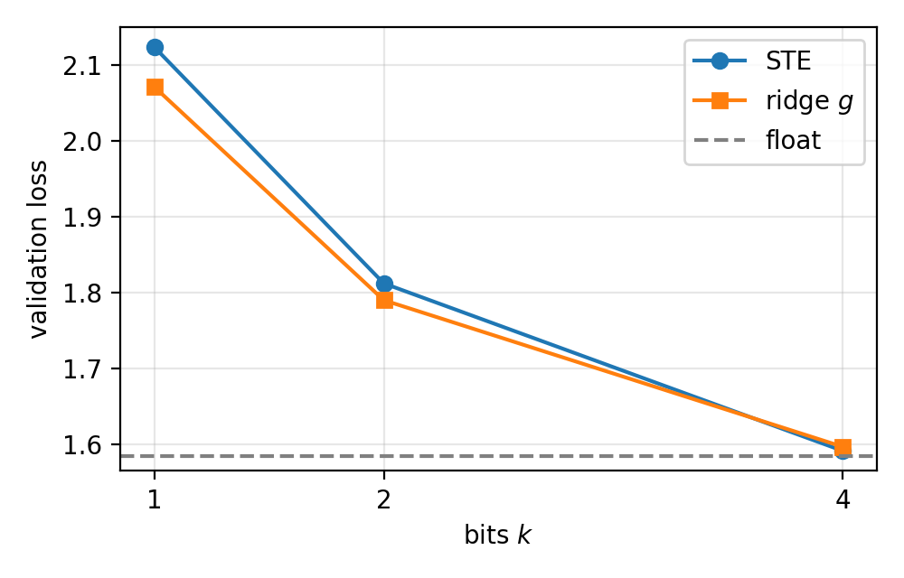

# Toy implementation

A small character-level GPT on Tiny Shakespeare, trained with quantized weights and activations. This mirrors the paper's nanoGPT experiment (Fig. 1a) at laptop scale.

## Question

At 1–2 bits, does STE training become unstable, and does the paper's ridge dequantization $g$ fix it?

## Runs

| method | bits |
|---|---|
| float | – (baseline) |
| STE | 1, 2, 4 |
| ridge $g$ ($\lambda = 0.01$) | 1, 2, 4 |

All runs use the same seed, data, model and optimizer. Only the dequantization step differs.

## Outputs

1. Training and validation loss against step at 1 bit, STE vs. ridge (our version of Fig. 1a).
2. Final validation loss against bits for float, STE and ridge.
3. A gradient check: perturbing the rounding error $\delta$ leaves STE's local gradient unchanged but changes ridge's.

## Results

Final validation loss after 3000 steps (lower is better). No run diverged.

| bits | STE | ridge $g$ |
|---|---|---|
| 1 | 2.123 | 2.071 |
| 2 | 1.812 | 1.790 |
| 4 | 1.592 | 1.597 |

Float baseline: 1.586.




Gradient check (`grad_check.py`, 1 bit, block of 64): two inputs with the same integers $q$ but rounding errors $\delta$ that differ by up to 0.106. The gradient reaching $x$ changes by 0.0000 under STE and by up to 0.0144 under ridge.

## Files

- `config.py`: all hyperparameters and the quantization settings (`METHOD`, `BITS`, `LAMBDA`)
- `data.py`: dataset, character tokenizer, 90/10 split, `get_batch`
- `data/tinyshakespeare.txt`: the dataset (about 1.1M characters)
- `model.py`: char-level GPT adapted from my `gpt.py`; linear layers inside the blocks are built by `Lin()` so they can be swapped for quantized ones
- `quant.py`: quantizer $q=f(x)+\text{stopgrad}(\delta)$, standard dequantization `x_hat`, ridge dequantization `g`, and `QLinear`
- `train.py`: trains one configuration, saves loss curves to `runs/<name>.json`
- `plots.py`: reads `runs/*.json`, writes the two figures to `plots/`
- `grad_check.py`: same $q$, different $\delta$; STE's gradient does not change, ridge's does

## Run

```bash
cd implementation
python data.py    # sanity check of the data pipeline
python model.py   # sanity check: forward pass, initial loss ≈ ln(65)
python train.py --method float
python train.py --method ste --bits 1
python train.py --method ridge --bits 1
python plots.py
python grad_check.py
```

## Debugging: why our STE does not blow up

The paper's STE loss explodes at 1 bit (Fig. 1a); ours did not. We tested one change at a time on the toy model (A1W1, same seed). "Residual" is the RMS of the residual stream after the last block. Logs: `runs/debug/`.

| step | change | STE val | ridge val | STE residual (start → end) | ridge residual |
|---|---|---|---|---|---|
| 0 | none, 1000 steps | 2.278 | 2.211 | 4.9 → 53 | 0.2 |
| 1 | no LayerNorm, 500 steps | 2.513 | 2.551 | 17.8 → 3.3 | 2.1 |
| 2a | lr 3e-3 | 2.563 | 2.182 | 4.9 → 494 | 0.5 |
| 2b | lr 1e-2 | 2.914 | 2.259 | 4.9 → 7295 | 11 |
| 3 | 5000 steps | 2.087 | 2.002 | 4.9 → 95 | 0.4 |

1. STE does blow up, inside the network: its residual stream is ~250x larger than with $g$ and keeps growing. The loss does not show it.
2. LayerNorm is what allows this. Without it the blow-up disappears and STE and $g$ train about equally (badly). LayerNorm makes each layer scale-invariant, so the oversized 1-bit outputs cost nothing in the loss and nothing pulls them back.
3. A higher learning rate makes it worse: at lr 1e-2 the residual reaches ~7300, STE's loss stops improving after step ~350 and rises (2.83 → 2.91), while $g$ keeps improving. This is the start of the divergence in the paper.
4. Longer training alone does not break it: at 5000 steps the residual is still growing (95) but the loss is fine.

Run with `python train.py --method ste --bits 1 [--no_ln] [--lr 3e-3] --iters N --name debug/<name>`.
